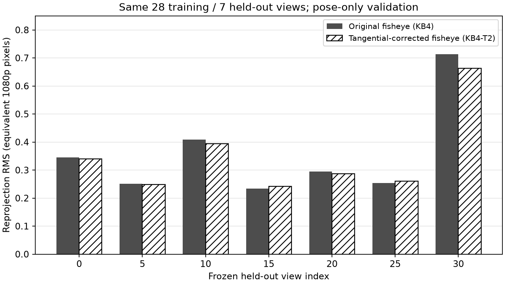

# 修正后的鱼眼模型 KB4-T2 实验

实验日期：2026-11-04。原图是用户确认的北京时间2026-11-03 02:31–02:46新HDMI镜头棋盘采集。本实验保留KB角度映射，在径向映射后添加p1、p2两项偏心切向修正；没有改成Brown透视模型。

## 结果

采用固定35张有效图，28张训练、7张留出，每张54个角点。两种模型使用相同原图角点、相同普通最小二乘损失、相同像素空间外参细化。留出图只估计外参，不更新内参或畸变参数。误差均为1080p等效像素，来自960×540原始灰度快照乘2，非原生全分辨率重新采集。

| 指标 | 原鱼眼KB4 | 加切向修正KB4-T2 |
|---|---:|---:|
| 训练全部角点RMS | 0.381927 | 0.380265 |
| 留出逐图RMS均值 | 0.357415 | 0.347698 |
| 留出全部角点合并RMS | 0.389965 | 0.374191 |
| 留出最差单图RMS | 0.713095 | 0.662656 |

留出逐图RMS均值降低 **2.72%**，绝对下降 0.009717 px；7张中5张改善、2张略变差。结果支持小幅改善，不支持显著画质提升或所有图像均改善的结论。仅本批数据的固定划分，尚未做跨采集批次泛化验证。

历史0.391519 px采用去畸变归一化平面的solvePnP外参，没有进一步最小化原像素误差。本次对两模型统一在原像素空间优化外参后，KB4基线为0.357415 px。不能把0.391519到0.347698的全部差值归功于切向修正。

## 六个拟合系数

以下是28张训练得到的实验参数，不是现有位流参数。

| 参数 | 数值 |
|---|---:|
| k1 | -0.022400549508784 |
| k2 | 0.00030943642014575 |
| k3 | -0.0040590911452379 |
| k4 | 0.00095564616368851 |
| p1 | 9.3358053956074e-05 |
| p2 | 0.000558442297749 |

1920×1080等效内参：fx=808.2406106215，fy=810.1214773740，cx=940.5473829573，cy=556.4273837364；skew=0。
快照到原生坐标为u_native=2u_snapshot+0.5、v_native=2v_snapshot+0.5；畸变系数不缩放。

## 模型定义

令x=X/Z、y=Y/Z、r=sqrt(x²+y²)、theta=atan(r)。

- theta_d=theta*(1+k1*theta²+k2*theta⁴+k3*theta⁶+k4*theta⁸)
- qx=x*theta_d/r，qy=y*theta_d/r，r=0用连续极限。
- dx=2*p1*qx*qy+p2*(3*qx²+qy²)
- dy=p1*(qx²+3*qy²)+2*p2*qx*qy
- u=fx*(qx+dx)+cx，v=fy*(qy+dy)+cy。

p1=p2=0时精确退化成现有KB4模型。这是KB4加两项切向扩展，不是OpenCV原生四参数fisheye，也不是原始KB论文完整非对称模型。工程定义参考[Project Aria可变径向阶数的鱼眼/切向模型](https://github.com/facebookresearch/Aria_data_tools/blob/main/src/sensors/camera/projection/FisheyeRadTanThinPrism.h)，取4径向项、2切向项、无薄棱镜，独立fx/fy；本文p1对应Aria p1，p2对应Aria p0。

## 逐图留出结果

| 图像索引 | KB4 RMS | KB4-T2 RMS | 降幅 |
|---|---:|---:|---:|
| 0 | 0.345060 | 0.340197 | +1.41% |
| 5 | 0.251452 | 0.248669 | +1.11% |
| 10 | 0.408912 | 0.394101 | +3.62% |
| 15 | 0.234469 | 0.241854 | -3.15% |
| 20 | 0.295333 | 0.286651 | +2.94% |
| 25 | 0.253583 | 0.259756 | -2.43% |
| 30 | 0.713095 | 0.662656 | +7.07% |



七张原图/KB4/KB4-T2对比图为held-XX-comparison.png；两种校正严格使用相同Kout、输出尺寸和裁剪窗口。示例：[第30张留出图](held-30-comparison.png)。它们是离线PC校正预览，不是实板截图；不能用图像整体位移或裁剪差别替代误差评价。

## 数值核验和运行记录

- 图像、metadata、原始灰度payload SHA与CRC核对；35张图均与未校正原始payload逐字节相符。
- 固定训练/留出互斥且覆盖35张图；使用原有筛选结果，没有根据模型表现重选图。
- p1=p2=0与OpenCV投影最大差为 0 px。
- 独立显式KB4-T2投影与实现最大差 1.14e-13 px。
- 解析Jacobian与中心差分最大尺度化差 4.37e-08。
- 三组切向初值均收敛到相同训练代价，按训练代价选择，未根据留出结果选参数。
- 候选径向函数0–90°最小导数 0.735570>0；同输出视场采样网格上切向Jacobian最小行列式 0.995294>0；映射有限、棋盘正深度、焦距为正。网格检查不是全视场连续证明。
- 原始脚本、环境版本、完整内外参和图像身份：result.json；逐图误差：held-out-errors.csv；提取角点：corners.npz；最终校验：final-validation.json。

复现命令（输出目录必须全新）：

```powershell
.venv/Scripts/python.exe distortion/tools/calibrate_kb_tangential.py --manifest distortion/work/hdmi-camera-snapshot-20261102-a/new-lens-calibration-c.json --output distortion/work/hdmi-kb-tangential-NEW
```

本次没有修改正式标定profile、RTL或板上位流。现有FPGA径向ROM不能单靠替换六个数值实现切向校正；如后续采用，需要在鱼眼径向坐标后加入二维切向运算，并重新验证定点误差、时序和吞吐。本实验不推算FPGA帧率变化。
